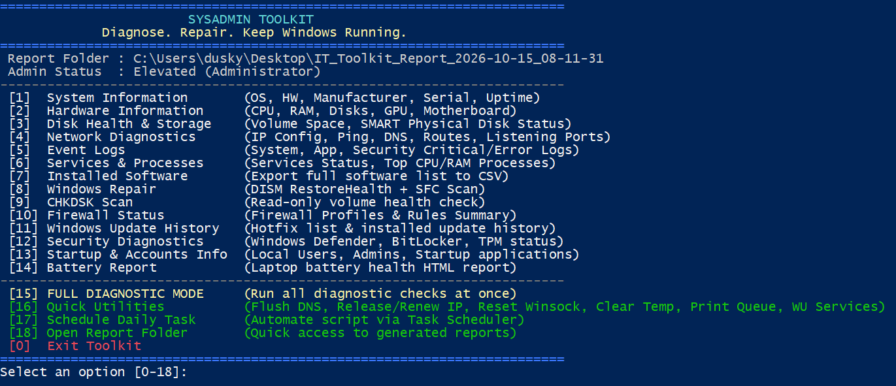

# SysAdmin Toolkit

> **Tagline:** Diagnose. Repair. Keep Systems Running.

A comprehensive, all-in-one diagnostic, repair, and maintenance IT toolkit engineered for technical support professionals, sysadmins, and IT technicians across **Windows** and **Linux** environments. Collects system specs, inspects hardware, evaluates disk health, audits device drivers, inspects SMB network shares, analyzes event logs, diagnoses local and extended network issues, inspects security/encryption/TPM settings, audits startup items & user accounts, performs system & package repairs, and generates consolidated reports.



---

## 🛠️ Key Features

- **System Information:** Collects OS build/kernel, architecture, computer model, serial number, uptime, and registered user info.
- **Hardware Information:** Detailed specifications for CPU (cores, clock speed), RAM (slots, capacity, speed), Motherboard, and GPU (resolution, driver version).
- **Disk Health & Storage:** Logical volume space usage and physical disk SMART health status (`smartctl` on Linux).
- **Device Driver & Kernel Diagnostics:** Audits Plug and Play hardware devices / kernel `dmesg` logs for driver errors, missing drivers, and hardware issues.
- **Network Diagnostics:** IP configuration, active network adapters, ICMP ping tests, DNS server checks, routing table, ARP cache, and listening ports.
- **Extended Network Check:** Public IP address lookup, WAN domain resolution & latency checks, and Hosts file (`/etc/hosts` or `C:\Windows\System32\drivers\etc\hosts`) security audit for unauthorized redirects.
- **SMB Shares & Security:** Audits active network shares, active SMB sessions, and checks for insecure SMBv1/legacy protocol configurations.
- **Event Logs & Journald:** Queries recent Critical and Error entries across system logs (`journalctl` / `syslog` / `auth.log` on Linux; System, Application, and Security logs on Windows).
- **Services & Processes:** Identifies stopped/failed automatic services and highlights top CPU and Memory consuming processes.
- **Installed Software:** Generates a full inventory of installed software across package managers (`dpkg`, `rpm`, `pacman`, `snap`, `flatpak`, Windows Registry) and exports to CSV and TXT formats.
- **System & Package Repair:** Executes `DISM RestoreHealth` + `sfc /scannow` on Windows, or package manager repairs (`dpkg --configure -a`, `apt install -f`, `systemctl reset-failed`) on Linux.
- **Filesystem / CHKDSK Scan:** Read-only health check for disk and volume integrity (`e2fsck` read-only check on Linux).
- **Firewall Status:** Status of Firewall profiles (`UFW`, `Firewalld`, `iptables` on Linux; Domain/Private/Public on Windows) along with active rule summaries.
- **Update History:** Displays installed hotfixes and package update transaction records sorted by date.
- **Security Diagnostics:** Inspects Defender/ClamAV status, BitLocker/LUKS volume encryption, SELinux/AppArmor, and TPM health.
- **Startup & Accounts Info:** Audits startup applications, local user accounts, sudo/administrator group members, and desktop autostart items.
- **Battery Report:** Generates an HTML battery health and capacity report.
- **Full Diagnostic Mode:** Runs all diagnostic functions sequentially and creates a timestamped report directory.
- **Quick Maintenance Utilities:** Quick actions to Flush DNS (`resolvectl`), Release & Renew IP (`dhclient`/`nmcli`), Reset Network Stack, Clear Temporary Files, Purge Print Queue (`CUPS`), Restart Update Services, Create System Snapshot (`Timeshift`/`Snapper`), Update Antivirus Signatures (`ClamAV`), and Reset Package Manager Cache (`apt clean`/`dnf clean`).
- **Open Report Folder:** Fast 1-click access to all generated reports (`xdg-open` on Linux).
- **Automated Task Integration:** Automated daily diagnostic task setup via Task Scheduler (Windows) or Cron (Linux).

---

## 🚀 Getting Started

### 🐧 Linux Version (`SysAdmin_Toolkit.sh`)

#### Prerequisites
- **Operating System:** Ubuntu, Debian, RHEL, CentOS, Fedora, Arch Linux, or compatible distributions.
- **Shell:** Bash 4.0+
- **Privileges:** `sudo` / root privileges recommended for full functionality (SMART checks, journalctl, firewall, package repair).

#### Usage Instructions

1. **Make Script Executable:**
   ```bash
   chmod +x ./SysAdmin_Toolkit.sh
   ```

2. **Run Interactive Menu (with sudo for full diagnostics):**
   ```bash
   sudo ./SysAdmin_Toolkit.sh
   ```

3. **Automated Non-Interactive Run:**
   ```bash
   sudo ./SysAdmin_Toolkit.sh -AutoRun
   ```

---

### 🪟 Windows Version (`SysAdmin_Toolkit.ps1`)

#### Prerequisites
- **Operating System:** Windows 10, Windows 11, or Windows Server 2016+
- **PowerShell Version:** Windows PowerShell 5.1 or PowerShell 7+
- **Privileges:** Administrator privileges required for full functionality (DISM, SFC, Event Logs, Firewall, BitLocker, Defender, TPM, System Restore).

#### Usage Instructions

1. **Open PowerShell as Administrator**
   Right-click PowerShell or Windows Terminal and select **Run as Administrator**.

2. **Unblock Downloaded File (if blocked by Windows):**
   ```powershell
   Unblock-File .\SysAdmin_Toolkit.ps1
   ```

3. **Set Execution Policy / Bypass Execution Restrictions:**
   ```powershell
   Set-ExecutionPolicy Bypass -Scope Process
   ```

4. **Run the Script:**
   ```powershell
   .\SysAdmin_Toolkit.ps1
   ```
   *Alternatively, run directly with execution policy bypass:*
   ```powershell
   powershell -ExecutionPolicy Bypass -File .\SysAdmin_Toolkit.ps1
   ```

---

## 📁 Output Reports

Each session creates a timestamped folder on the current user's Desktop (or Home directory):
`Desktop/IT_Toolkit_Report_YYYY-MM-DD_HH-mm-ss/`

It contains:
- `Technician_Log.txt` - Complete log of all actions executed during the session.
- `SystemInfo.txt` & `ComputerInfo.txt` & `OperatingSystem.txt` - Operating system and system architecture details.
- `HardwareInfo.txt` - CPU, RAM layout, GPU, and motherboard specs.
- `DiskHealth.txt` - Drive space and SMART status.
- `DriverDiagnostics.txt` - Device Manager / PnP / Kernel dmesg hardware driver status.
- `InstalledSoftware.csv` & `InstalledSoftware.txt` - Full inventory of installed software packages.
- `NetworkDiagnostics.txt` - Adapter details, ping results, DNS, routes, and listening ports.
- `NetworkExtended.txt` - External Public IP, WAN DNS resolution, and Hosts file security audit.
- `SmbDiagnostics.txt` - SMB/NFS shares, active sessions, and protocol security status.
- `EventLogs_RecentErrors.txt` - Critical/Error logs from journalctl/syslog or Windows Event Viewer.
- `Services.txt` & `TopProcesses.txt` - Service states and top resource-consuming processes.
- `FirewallStatus.txt` - Active firewall profiles and rule summaries.
- `PackageUpdateHistory.txt` / `WindowsUpdateHistory.txt` - Installed updates and transaction history.
- `SecurityDiagnostics.txt` - Antivirus, drive encryption (BitLocker/LUKS), SELinux/AppArmor, and TPM status.
- `StartupAndAccountInfo.txt` - Local accounts, sudo/admin members, and startup applications.
- `SystemRepair.txt` / `WindowsRepair.txt` - Logs from DISM, SFC, or package manager repairs.
- `BatteryReport.html` & `BatteryReport.txt` - Comprehensive laptop battery analytics.

---

## 🤖 Automating Daily Checks

- **Linux (Cron):** Select **[20] Schedule Daily Task** in `SysAdmin_Toolkit.sh` (or run as root) to register a daily cron job in `/etc/cron.d/sysadmin_toolkit_daily` at 8:00 AM.
- **Windows (Task Scheduler):** Select **[20] Schedule Daily Task** in `SysAdmin_Toolkit.ps1` to register `SysAdmin_Toolkit_Daily_Diagnostics` in Task Scheduler at 8:00 AM.

---

## 📄 License
Released under the MIT License. Designed for IT Professionals and Technical Support teams.
